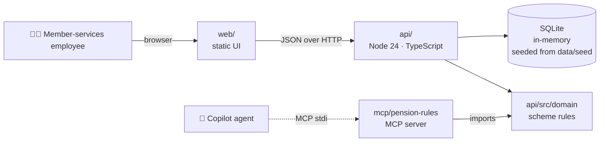
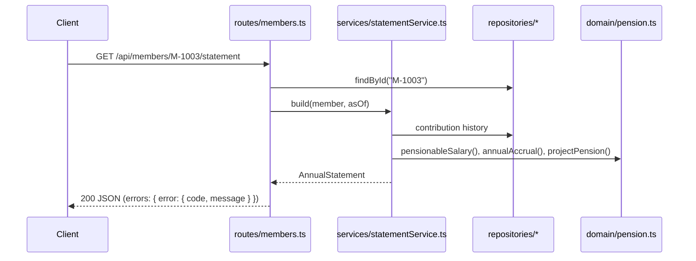

# Contoso Pension Platform — Architecture

> Fictional pension fund. **Synthetic data only. Simplified, NOT real pension rules.**

## 1. Big picture



| Folder | What lives there | Why it matters in the workshop |
|---|---|---|
| `api/src/domain` | Pure business rules (pensionable salary, accrual, projection) | The "brain" agents must understand (A2, A4) |
| `api/src/repositories` | SQL only — no business rules | Convention agents must respect (A4) |
| `api/src/services` | Combine repositories + domain | Where the statement bug lives (A5) |
| `api/src/routes` | HTTP endpoints, validation, error envelope | Where new endpoints go (A2, A4) |
| `mcp/pension-rules` | Hand-written MCP server (stdio) | Tool governance (A3) |
| `docs/domain`, `docs/adr` | Enterprise knowledge | Context engineering (A4) |
| `.github/` | Workflows, templates, (later) agents, skills, hooks, instructions | Engineering controls & agentic CI/CD (A1, A5) |

## 2. Request flow (layered architecture — ADR-0003)



## 3. Design decisions

| ADR | Decision |
|---|---|
| [0001](adr/0001-zero-dependency-runtime.md) | Zero runtime dependencies — Node 24 runs TypeScript natively, `node:sqlite`, `node:test` |
| [0002](adr/0002-error-envelope.md) | One error envelope for every API error |
| [0003](adr/0003-layered-architecture.md) | routes → services → repositories / domain; business rules only in `domain` |

## 4. Run it

```bash
npm start            # http://localhost:3000  (UI)  ·  /api/health  ·  /openapi.yaml
npm test             # all unit + API + MCP tests (node:test)
npm run verify       # environment check
```
