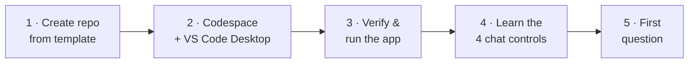
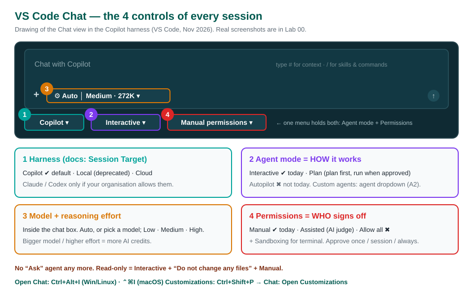
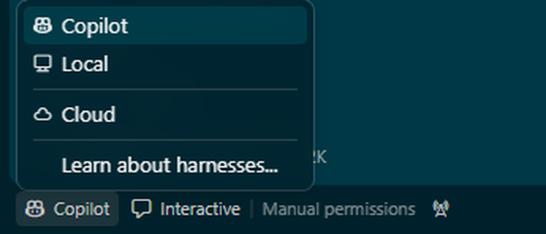
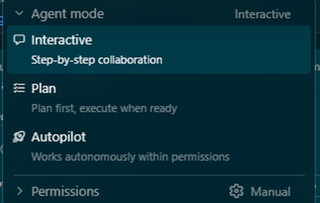
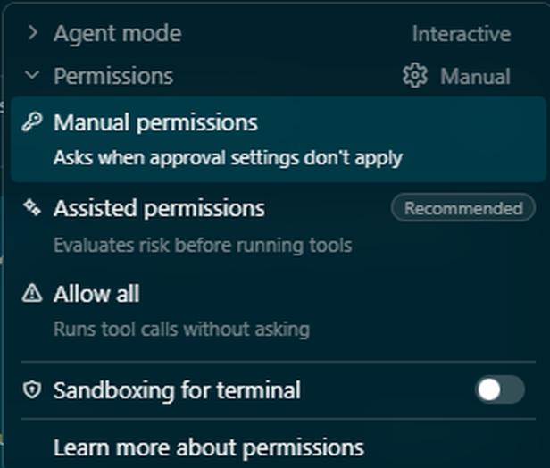
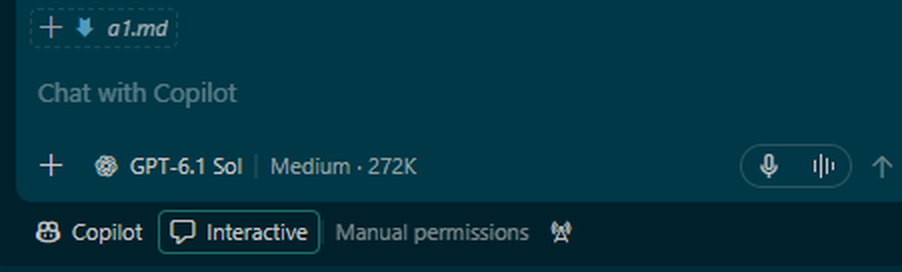

# Lab 00 · Setup & orientation

> ⏱️ **15 min** · 🎯 Everyone · 🧩 Builds on: nothing · 🆘 Stuck? See [Troubleshooting](#-troubleshooting)

## 🎯 Goal

By the end of this lab you have:

- ✅ Your **own copy** of the workshop repo running in a **Codespace** (opened in VS Code Desktop)
- ✅ The **Contoso** app running and all tests green
- ✅ A first Copilot chat where **you** chose the 4 controls on purpose

## 🗺️ Lab map



---

## Step 1 — Create your own repository (⏱️ 2 min)

**Why:** every participant needs a repo they *own* — later labs change settings (rulesets, secrets) that need admin rights.

1. Open the workshop template repository link your coach shared.
2. Click **Use this template** → **Create a new repository**.
3. **Owner:** your GitHub account (or the organisation your coach names) · **Name:** `contoso-workshop` · **Visibility:** **Private**.
4. Click **Create repository**.

> 👀 **Expected:** your repo opens at `github.com/<you>/contoso-workshop` and the **Actions** tab shows a first **CI** run (green ✅ after ~1 minute).

---

## Step 2 — Start a Codespace and open it in VS Code Desktop (⏱️ 4 min)

**Why:** the Codespace has Node 24, the GitHub CLI and the Copilot CLI preinstalled — identical for all 100 participants. VS Code **Desktop** supports every agent feature we use today.

1. In your repo: **Code** (green button) → **Codespaces** tab → **Create codespace on main**.
2. Wait until the terminal shows `Contoso workshop — environment check` (≈ 2 min).
3. Bottom-left corner: click **Codespaces** → **Open in VS Code Desktop**. Accept the prompts to open VS Code and sign in to GitHub.

> 👀 **Expected:** VS Code Desktop with `Codespaces: …` in the bottom-left corner.
> ⚠️ **Can't install/open VS Code Desktop?** Continue in the browser — almost everything works; tell your coach which step fails.

---

## Step 3 — Verify the environment and run the app (⏱️ 3 min)

1. Open a terminal: **Terminal → New Terminal** (`` Ctrl+` ``).
2. Run:
   ```bash
   npm run verify
   ```
   > 👀 **Expected:** ✅ for Node.js 24+, node:sqlite, git and *Unit tests (30 passing)*. ⚠️ on optional tools is fine.
3. Start the app:
   ```bash
   npm start
   ```
4. A notification offers to open port **3000** → **Open in Browser** (or **Ports** tab → globe icon next to 3000).
5. Click member **M-1003** (Fatima, 60 % part-time). Look at *Pensionable salary (current)*.

> 👀 **Expected:** the Contoso UI with 8 synthetic members. Remember M-1003's numbers — **one of them is wrong** (you'll fix it with an agent in lab A5).

6. Stop the app with `Ctrl+C` when you're done looking (start it again whenever you need it).

---

## Step 4 — Learn the 4 controls of every chat (⏱️ 3 min)



| # | Control | Where in the Chat view | Analogy | Today's default |
|---|---|---|---|---|
| 1 | **Harness** (the docs also call it *Session Target*) | Bottom bar, **first** button | *Which kitchen* cooks the meal | **Copilot** |
| 2 | **Agent mode** | Bottom bar, **second** button (shows *Interactive*) | *How the chef works* — with you step by step (Interactive), menu first (Plan), or alone (Autopilot) | **Interactive** (A2 also uses **Plan**) |
| 3 | **Model** (+ reasoning effort) | **Inside** the chat box, bottom-left (e.g. `<model> │ Medium · 272K` = model │ effort · context size) | *Which brain* the chef uses — bigger brain = better and more expensive | **Auto** |
| 4 | **Permissions** | Same menu as the agent mode, **Permissions** section (bottom bar shows *Manual permissions*) | *Who signs off* before the chef uses a knife | **Manual permissions** |

1. Open the Chat view: `Ctrl+Alt+I` (macOS `⌃⌘I`).
2. Click **New Chat (+)**.
3. Set the controls — **in this order**:

   **4.1 · Harness → Copilot.** Click the first button in the bottom bar and choose **Copilot**.

   

   **4.2 · Agent mode → Interactive.** Click the second button. One menu opens with two sections, **Agent mode** and **Permissions**. Under **Agent mode**, choose **Interactive** (*step-by-step collaboration*).

   

   **4.3 · Model → Auto.** Click the model name **inside** the chat box and choose **Auto**. If *Auto* isn't listed, keep the model that is selected.

   **4.4 · Permissions → Manual permissions.** Open the same menu again and expand **Permissions** (or click *Manual permissions* in the bottom bar). Choose **Manual permissions**. Leave **Sandboxing for terminal** as it is.

   

4. Check the bottom bar. It reads **Copilot · Interactive · Manual permissions**:

   

| Agent mode | What it does | When we use it today |
|---|---|---|
| **Interactive** | Works with you step by step: edits and commands ask first (with Manual permissions) | Most labs |
| **Plan** | Researches and writes a plan first, then waits — *executes only when you approve* | A2 baseline, A4 fallback |
| **Autopilot** | Works alone until done: auto-approves every tool, retries, answers its own questions | ❌ **Never** in this workshop |

| Permissions | What it does | Today |
|---|---|---|
| **Manual permissions** | Asks you before any tool call that your approval settings don't already allow | ✅ Always |
| **Assisted permissions** (*Recommended* label) | An AI judge decides which tool calls are safe; the rest ask you | ❌ Not today: we want to *see* every call while learning |
| **Allow all** | Runs every tool call without asking | ❌ Never |

> 💡 **No "Ask" agent any more.** Older tutorials say *Agent → Ask / Agent / Edit* or *Chat > Ask*. In today's Copilot harness you choose an **agent mode** (Interactive, Plan, Autopilot). To keep a chat read-only, say **"Do not change any files"** in the prompt and keep **Manual permissions**: any edit or command must still be approved by you.
> 💡 **Custom agents** (lab A2) appear in an **agent dropdown** once your repo contains `.github/agents/*.agent.md` files.

> ⚠️ **Don't see "Copilot" in the harness picker?** Update VS Code (Help → Check for Updates) and the GitHub Copilot Chat extension, then reload. Still missing → your organisation may restrict it: tell a coach.
> ⚠️ **A banner says "1 user customization needs an update… Review Migrations"?** It's about **your own** user-level settings, not this repo. You can ignore it for today.

---

## Step 5 — Your first question to an agent (⏱️ 3 min)

**Why:** exploring unknown code *before* changing it is the safest first move. Interactive mode + Manual permissions + "Do not change any files" = look, don't touch.

1. Keep **Copilot · Interactive · Manual permissions**. Paste this prompt and press **Enter**:
   ```text
   Explain the architecture of this repository in 5 bullet points.
   Then explain how the annual statement for a member is calculated, naming the files and functions involved.
   Do not change any files.
   ```
2. While it answers, **expand the tool calls** (the collapsed lines such as *Read file…* / *Searched…*) to see which files it actually opened.
3. If Copilot asks to **edit a file** or **run a command**: click **Skip** (or **Deny**). This question needs neither.

> 👀 **Expected:** a summary mentioning `api/src/domain/pension.ts`, `api/src/services/statementService.ts`, the layers (routes → services → repositories/domain) and SQLite.
> 💡 **Observe, don't assume:** an answer that names files it never opened is a guess. The tool calls are your evidence.

### ✅ Checkpoint

- [ ] `npm run verify` shows **✅ Ready for the workshop**
- [ ] The app shows 8 members on port 3000
- [ ] Your bottom bar reads **Copilot · Interactive · Manual permissions**
- [ ] You can name the 3 files involved in the statement calculation

---

## 🆘 Troubleshooting

| Symptom | Fix |
|---|---|
| Codespace creation is blocked | Your org may not allow Codespaces for this owner. Create the repo under your **personal** account, or use the **dev container locally**: clone the repo, open in VS Code with Docker running → **Dev Containers: Reopen in Container**. |
| `npm run verify` shows ❌ Node.js | The dev container did not build. Command Palette → **Codespaces: Rebuild Container**. |
| Port 3000 does not open | **Ports** tab → right-click 3000 → **Open in Browser**. |
| Chat says you have no access | Check you're signed in with the GitHub account that has your organisation's Copilot license (Accounts icon, bottom-left). |
| Copilot harness missing | Update VS Code & extension; if org policy blocks it, use **Local** for today and tell a coach (it's deprecated, but works for most labs). |
| No **Interactive / Plan / Autopilot** menu, but an old *Ask / Agent / Plan* dropdown | You are on an old VS Code or on the **Local** harness. Update VS Code, then pick **Copilot** in the harness picker. |
| "1 user customization needs an update… Review Migrations" banner | About your own user settings, not this repo. Ignore it today, or click **Review Migrations** later. |

## 📚 Learn more

- [Choose an agent harness](https://code.visualstudio.com/docs/agents/run/agent-harnesses)
- [Chat in VS Code](https://code.visualstudio.com/docs/chat/chat-overview)
- [Creating a codespace](https://docs.github.com/en/codespaces/developing-in-a-codespace/creating-a-codespace-for-a-repository)

➡️ **Next:** [Lab A1 · Models, Enterprise Configuration & Engineering Controls](../a1-models-enterprise-controls/README.md)
