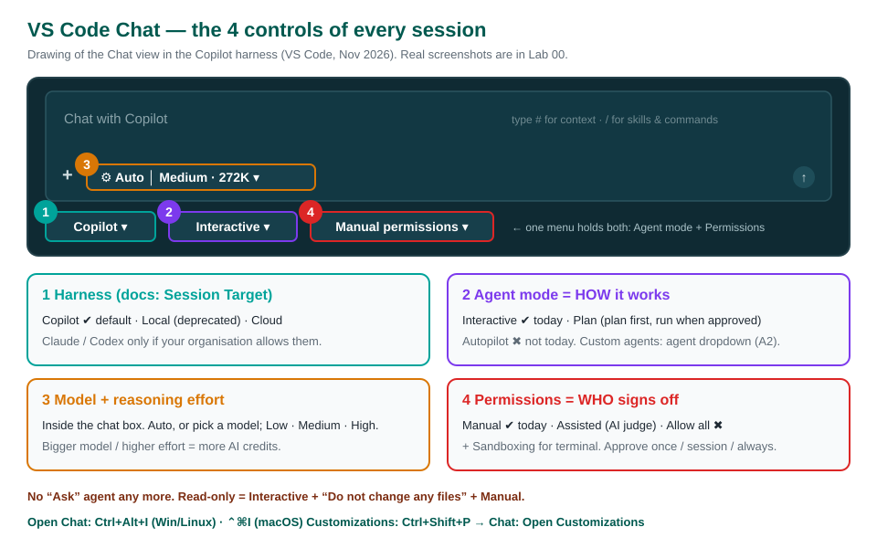

# 📌 Cheat sheet — GitHub Copilot in VS Code (verified for VS Code 1.146 · Nov 2026)



## Keyboard & commands

| I want to… | Do this |
|---|---|
| Open the Chat view | `Ctrl+Alt+I` (Win/Linux) · `⌃⌘I` (macOS) — or title bar **Chat** menu → **Open Chat** |
| Start a fresh chat | **New Chat (+)** at the top of the Chat view |
| Open the Command Palette | `Ctrl+Shift+P` (Win/Linux) · `⇧⌘P` (macOS) |
| Manage agents, instructions, skills, hooks, MCP servers, tools | Command Palette → **Chat: Open Customizations** |
| Open the Agents window (see subagents, sessions) | Title bar → **Open in Agents** |
| Plan before coding | Agent mode → **Plan** (bottom bar, second button) |
| Run a skill | Type `/` + the skill name, e.g. `/add-api-endpoint` |
| Attach context | Type `#` → `#file`, `#codebase`, `#terminalSelection` … or **Add Context** |
| Free up context | `/compact` — or start a **New Chat** for a new task |
| See what the agent really did | Expand the tool calls in the response · **References** · **Agent Debug Logs** · `/debug` |
| Manage remembered approvals | Command Palette → **Chat: Manage Tool Approval** / **Chat: Reset Tool Confirmations** |
| Add an MCP server | **Chat: Open Customizations → MCP Servers → Add Server (+)** · or **MCP: Add Server** |
| See effective org policies | Command Palette → **Developer: Policy Diagnostics** |

## The 4 controls (choose them in this order)

| Control | Where | Today we use | Notes |
|---|---|---|---|
| **Harness** (docs: *Session Target*) | Bottom bar, 1st button | **Copilot** | Default. *Local* is deprecated (removed Feb 2027). *Cloud* runs the session remotely. Pick it **before** the first prompt. |
| **Agent mode** | Bottom bar, 2nd button | **Interactive** · **Plan** when a lab says so | **Autopilot** auto-approves everything: never today. There is **no** "Ask" or "Edit" agent and **no** "Chat > Ask" menu. |
| **Custom agent** | Agent dropdown (appears when the repo has `.github/agents/*.agent.md`) | Only in A2/A3 | E.g. **Feature Lead**, **Pension Advisor**. |
| **Model** (+ reasoning effort) | Inside the chat box, bottom-left | **Auto** unless the lab says otherwise | Model and effort (Low/Medium/High) = quality **and** cost (AI credits). |
| **Permissions** | Same menu as Agent mode → **Permissions** | **Manual permissions** | Approve each tool call. *Assisted* (AI judge) and *Allow all* exist; not today. Never `/yolo`. |

> 🔎 **Read-only question?** Interactive + "Do not change any files" in the prompt + Manual permissions → any edit or command still needs your click.

## Customization files (Copilot harness)

| File | Purpose | Lab |
|---|---|---|
| `.github/copilot-instructions.md` / `AGENTS.md` | Always-on repo rules | A4 |
| `.github/instructions/*.instructions.md` (`applyTo:`) | Rules for matching files | A4 |
| `.github/agents/*.agent.md` | Custom agent = role + tools + model | A2 |
| `.github/skills/<name>/SKILL.md` | Reusable workflow (+ scripts, references) → `/name` | A4 |
| `.github/hooks/*.json` | Deterministic actions on events (`preToolUse`…) | A1, A3 |
| `.mcp.json` (repo root, key `mcpServers`) | MCP servers shared with the team | A3 |
| `~/.copilot/mcp-config.json` | Your personal MCP servers ("Copilot Global") | A3 |

> ⚠️ Old tutorials mention `.vscode/mcp.json` (`servers`), "chat modes", `.prompt.md` files and `handoffs:` — those belong to the deprecated **Local** harness. Today we use the formats above.

## Terminal commands for this repo

```bash
npm start                    # run the app (port 3000)
npm test                     # all tests
npm run verify               # environment check
npm run catch-up -- a3       # jump to the end state of a lab
npm run audit                # tool-call audit report (hook + MCP server logs)
bash scripts/create-backlog-issues.sh   # create the backlog issues in your repo
copilot                      # GitHub Copilot CLI (interactive) · copilot -p "…" (one-shot)
```
