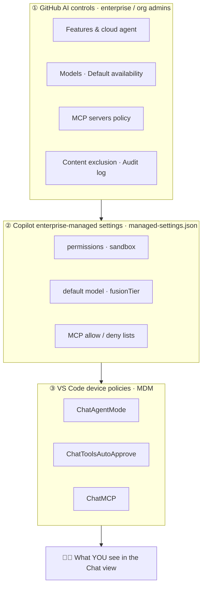
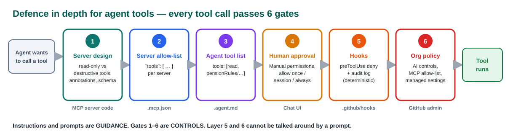
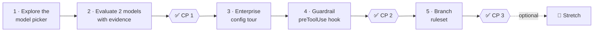
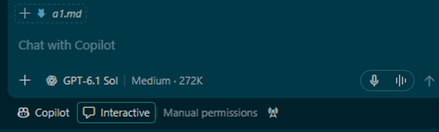
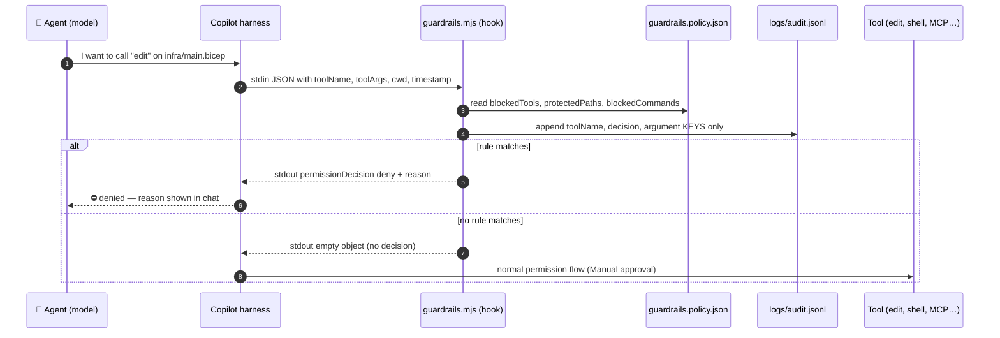

# Lab A1 · Models, Enterprise Configuration & Engineering Controls

> ⏱️ **40 min core + 10 min stretch** · 🎯 Intermediate · 🧩 Builds on: [Lab 00 · Setup](../00-setup/README.md)

> 🗣️ **Session flow (60 min):** 15 min instructor talk → 40 min core lab → 10 min stretch.

## 🎯 Goal

By the end of this lab you have:

- ✅ A **model scorecard** (`docs/evaluations/model-scorecard.md`) comparing two models on rule R1 — with every expected value **verified by code**, not by trust
- ✅ An **enterprise control map** (`docs/evaluations/control-map.md`): which control lives in which layer, and who owns it
- ✅ A working **preToolUse guardrail hook** (`.github/hooks/`) that blocks agent edits to protected paths — **7 unit tests green** and an audit log
- ✅ A **branch ruleset** on your repo: pull request + green `Test` check (+ Copilot code review) before anything reaches `main`

---

## 🧠 Concepts in 5 minutes

### 1. Models — pick the right brain for the job

| What | Why | Analogy | Example in Contoso |
|---|---|---|---|
| Each model has different strengths: **fast** models for simple, frequent tasks · **deep-reasoning** models for complex, multi-step work. **Auto** lets Copilot choose for you. | Model choice = **quality + cost**. A bigger brain is not always better — it is slower and burns more credits. | A **taxi vs. a moving truck**: both get you there; one is quick and cheap, the other carries a lot but costs more. | "Rename a variable" → fast model. "Find every edge case in rule R1" → deep-reasoning model. |

### 2. AI credits — the budget behind every prompt

| What | Why | Analogy | Example in Contoso |
|---|---|---|---|
| Billing is **GitHub AI Credits** (token-based, 1 credit = $0.01). **Business: 1,900** and **Enterprise: 3,900** credits per user per month, **pooled** across the organisation. | Long chats, big context and heavy models spend more. Subagents add usage too. | A **shared team fuel card**: everyone fills up from the same pool. | A team of 10 on Enterprise shares 39,000 credits/month. One person running a deep model all day spends the team's fuel. |

### 3. Enterprise configuration — 3 layers

| What | Why | Analogy | Example in Contoso |
|---|---|---|---|
| Copilot is configured in **3 layers**: GitHub **AI controls** policies · Copilot **enterprise-managed settings** · VS Code **device policies**. | A setting you can't find is probably decided one layer *above* you. | **Building security**: the landlord (GitHub), the office manager (managed settings), the lock on your desk (device). | A model missing from your picker? Layer 1 (model policy) decided that — not VS Code. |



### 4. Engineering controls — guidance vs. enforcement

| What | Why | Analogy | Example in Contoso |
|---|---|---|---|
| **Probabilistic guidance** (instructions, prompts) *asks* the model to behave. **Deterministic controls** (hooks, permissions, rulesets, CI) *enforce* behaviour — no matter what the model "thinks". | A model can ignore, misread or be tricked (prompt injection). Code can't be talked around. | A **"please don't touch" sign** vs. a **locked door**. | "Never edit `infra/`" in instructions = sign. A preToolUse hook that denies edits to `infra/` = lock. |



> 💡 Instructions and prompts are **guidance**. Hooks, permissions, rulesets and CI are **controls**. Today you build two controls.

---

## 🗺️ Lab map



---

## Step 1 — Explore the model picker (⏱️ 3 min)

**Why:** you can only choose wisely if you know what's on the menu — and the menu is set by your organisation.

1. Open the Chat view: `Ctrl+Alt+I` (macOS `⌃⌘I`).
2. Click **New Chat (+)**.
3. Set **Harness** → **Copilot** (bottom bar, first button).
4. Open the **model picker**: click the model name **inside** the chat box, bottom-left (it looks like `<model> │ Medium · 272K`).
5. Look for: **Auto**, an "**Org default**" label, (maybe) **Copilot Fusion**, and the **reasoning effort** (*Low · Medium · High*) next to the model.
6. Open the [supported models](https://docs.github.com/en/copilot/reference/ai-models/supported-models) doc in your browser.
7. Compare: which models from the doc are **missing** in your picker? Write down 2–3.

> 👀 **Expected:** a list of models plus **Auto**. Your list is probably **shorter** than the doc — your org's model policy decides what you see.
> ⚠️ **If not:** an empty or tiny list usually means a license/policy issue — check you're signed in with the GitHub account that has your organisation's Copilot license (Accounts icon, bottom-left).



> 💡 **Model vs. effort:** the model is *which brain*; the effort is *how long it thinks*. Both change quality, speed and AI credits.

<!-- 📸 SCREENSHOT: a1-01-model-picker.png — model picker open in a Copilot session, showing Auto, Org default and the effort levels -->

> 💡 Want strengths side by side? See the [model comparison](https://docs.github.com/en/copilot/reference/ai-models/model-comparison) doc.

---

## Step 2 — Evaluate two models with evidence (⏱️ 10 min)

**Why:** "this model feels smarter" is an opinion; a scorecard with verified numbers is evidence.

### 2a · Question for model A

1. Click **New Chat (+)**.
2. Set, in this order: **Harness** → **Copilot** · **Agent mode** → **Interactive** · **Model** → *model A* (pick one from the picker, keep effort **Medium**) · **Permissions** → **Manual permissions**.
3. Paste this prompt:

```text
Explain rule R1 (the pensionableSalary function in api/src/domain/pension.ts) in 3 bullet points.
Then propose 5 edge-case test inputs (fullTimeSalary, partTimeFactor).
For each input give the EXACT expected return value, or the exact error it throws.
Answer as a markdown table: | # | fullTimeSalary | partTimeFactor | expected | why it is an edge case |
Do not change any files. Do not run any commands.
```

4. Note how long the answer took (fast / ok / slow).

### 2b · Same question for model B

1. Click **New Chat (+)** — a **new** chat, so model B doesn't see model A's answer.
2. Same controls, but **Model** → *model B* (a **different** model, same effort).
3. Paste the **same** prompt.

> 👀 **Expected:** two tables of 5 rows each. They will differ in which edge cases they pick (franchise, cap, part-time, invalid factor…) and possibly in the expected values.

### 2c · Verify deterministically

1. Run this one-liner in the terminal. It calls the **real** function:

```bash
node -e "import('./api/src/domain/pension.ts').then(m=>{for (const [s,f] of [[52000,1],[46000,0.6],[150000,1],[16000,0.9]]) console.log(s,f,m.pensionableSalary(s,f))})"
```

> 👀 **Expected (exactly):**
> ```text
> 52000 1 34455
> 46000 0.6 17073
> 150000 1 120255
> 16000 0.9 0
> ```

2. Now check **the models' inputs**. Replace the pairs inside `[[…],[…]]` with the 5 inputs from model A (this version also prints errors):

```bash
node -e "import('./api/src/domain/pension.ts').then(m=>{for (const [s,f] of [[17545,1],[137801,1],[50000,0]]) {try{console.log(s,f,m.pensionableSalary(s,f))}catch(e){console.log(s,f,e.name+': '+e.message)}}})"
```

> 👀 **Expected for the sample pairs:** `17545 1 0` · `137801 1 120255` · `50000 0 RangeError: partTimeFactor must be greater than 0 and at most 1`

3. Repeat for model B's inputs.
4. Mark each model value ✅ (matches) or ❌ (doesn't match).

### 2d · Record the scorecard

1. Create the file below (copy-paste) and fill in both columns.

**`docs/evaluations/model-scorecard.md`**

````markdown
# Model scorecard — rule R1 (pensionableSalary)

> One run is a sample, not a benchmark. Synthetic data only — never paste secrets or real member data.

| | Model A | Model B |
|---|---|---|
| Model (name as shown in the picker) | | |
| Harness · Mode · Permissions | Copilot · Interactive · Manual | Copilot · Interactive · Manual |
| Reasoning effort | | |
| Date | | |

## Scores

| Criterion | How to score | Model A | Model B |
|---|---|---|---|
| Correctness verified | Expected values that match the `node -e` output (x / 5) | /5 | /5 |
| Edge cases found | Which did it cover? franchise boundary · salary cap · part-time · below franchise → 0 · invalid factor (0 or > 1) · negative salary | | |
| Hallucinations | Invented functions, parameters, files or rules? List them (none = 👍) | | |
| Latency feel | fast / ok / slow | | |
| Cost / credits | Relative cost of the model (supported-models doc) — heavier model = more AI credits | | |

## Verification output

```text
(paste the node -e output for model A and model B here)
```

## Verdict

- For **this kind of task** I would use: …
- Because: …
- Would I trust it **without** the `node -e` check? yes / no — why?
- To make this a real benchmark I would need: …
````

> 💡 **One run is not a benchmark.** Models are non-deterministic: run the same prompt again and you may get different edge cases. A fair comparison needs many tasks, several runs and a fixed scoring rule — today you practise the *method*.

### ✅ Checkpoint 1

- [ ] The first one-liner prints exactly `34455`, `17073`, `120255`, `0`
- [ ] `docs/evaluations/model-scorecard.md` exists: `ls docs/evaluations/model-scorecard.md` prints the path
- [ ] Every model value in your scorecard is marked ✅ or ❌ **based on `node -e` output**
- [ ] You can say in one sentence when you'd pick model A vs. model B

---

## Step 3 — Tour the enterprise configuration (⏱️ 6 min)

**Why:** most "Copilot can't do X" questions are answered by a policy one layer above you.

> ℹ️ You are **not** an org admin. This step is 👀 **look & discuss** — you change nothing.

1. On **github.com**: click your **profile picture** → **Settings** → look for **Copilot** in the sidebar.
2. Note which features and models are **enabled / disabled** and which say they are **managed by your organisation**.
3. In VS Code: `Ctrl+Shift+P` → **Developer: Policy Diagnostics**.
4. Scan the report for chat, agent, tool-approval and MCP policies (e.g. `ChatAgentMode`, `ChatToolsAutoApprove`, `ChatMCP`).
5. Create the control map below (copy-paste) and fill in **Owner in your organisation** and **Status** for each row.

> 👀 **Expected:** the Copilot settings page shows your features/models; **Policy Diagnostics** shows the effective policies on this machine (often few or none in a Codespace).
> ⚠️ **If not:** can't find a value? Write **❓ unknown** — finding the gaps *is* the result.

<!-- 📸 SCREENSHOT: a1-02-policy-diagnostics.png — Developer: Policy Diagnostics output in VS Code -->

**`docs/evaluations/control-map.md`**

```markdown
# Control map — GitHub Copilot in our organisation

Status: ✅ enforced · ⚠️ available but not set · ❓ unknown · 🔒 can't see (admin only)

| Layer | Control | Owner | Status |
|---|---|---|---|
| ① GitHub AI controls | Copilot features (chat, agents, cloud agent, code review) | | |
| ① GitHub AI controls | Model availability + "Default availability" for new models | | |
| ① GitHub AI controls | MCP servers in Copilot policy | | |
| ① GitHub AI controls | Content exclusion | | |
| ① GitHub AI controls | Audit log (agent actions) | | |
| ② Enterprise-managed settings | `permissions` / `sandbox` | | |
| ② Enterprise-managed settings | Default `model` / `fusionTier` | | |
| ② Enterprise-managed settings | MCP allow / deny lists | | |
| ③ VS Code device policies | ChatAgentMode · ChatToolsAutoApprove · ChatMCP | | |
| Repository | preToolUse guardrail hook (`.github/hooks/`) — Step 4 | me (this lab) | |
| Repository | Branch ruleset on `main` — Step 5 | me (this lab) | |
| Repository | CI check `Test` (`.github/workflows/ci.yml`) | | ✅ |
```

> 🧑‍🏫 **Instructor demo — Enterprise AI controls (5 min, admin view)**
> | Control | What the admin sets | Why it matters |
> |---|---|---|
> | **Models** | Enable / restrict models; "Default availability" for new models | Quality, cost and data-residency decisions |
> | **MCP** | "MCP servers in Copilot" policy; registry; managed allow/deny lists | Which external tools agents may call (lab A3) |
> | **Cloud agent** | Enable/disable the Copilot cloud agent per org/repo | Agents opening PRs autonomously (lab A5) |
> | **Content exclusion** | Paths/repos Copilot should ignore | Keeps sensitive files out of context |
> | **Audit log** | Agent actions (`actor_is_agent`) + usage metrics | Evidence for auditors: who/what changed what |

> ⚠️ **Content exclusion is not a wall.** Coverage for agents and the CLI is not guaranteed — an agent may still reach excluded content **indirectly** (e.g. via a terminal command or a tool). Treat it as one layer of **defence in depth**, never the only one.

---

## Step 4 — Build engineering control #1: a guardrail hook (⏱️ 15 min)

**Why:** a hook runs **your code** before every agent tool call — it can say "no" deterministically, and log what happened.

### 4a · How it works



| Concept | What it means here |
|---|---|
| **`{}` ≠ approval** | Returning `{}` means "no opinion" — your **Manual** approval still applies. |
| **Fail closed** | If the script **crashes**, the harness treats the preToolUse error as **deny**. Broken guardrail = locked door, not open door. ⚠️ A **timeout** falls through to normal permissions — keep hooks fast (`timeoutSec: 10`). |
| **Self-protection** | `.github/hooks/` is a protected path, so the agent **can't edit or disable its own guardrail**. Otherwise one prompt injection could switch the lock off. |
| **Audit** | Every decision is logged to `.github/hooks/logs/audit.jsonl` (gitignored) — argument **keys** only, never values (no sensitive data in logs). |

### 4b · Create the 4 files (copy-paste)

1. Create each file below with exactly this content.

**`.github/hooks/guardrails.json`** — registers the hook for the `preToolUse` event

```json
{
  "version": 1,
  "hooks": {
    "preToolUse": [
      {
        "type": "command",
        "command": "node .github/hooks/guardrails.mjs",
        "timeoutSec": 10
      }
    ]
  }
}
```

**`.github/hooks/guardrails.policy.json`** — the rules (data, not code — easy to review)

```json
{
  "_comment": "Engineering controls for agent tool calls. Read by guardrails.mjs. Changing this file requires a reviewed PR (see CODEOWNERS).",
  "blockedTools": ["delete_member_data"],
  "protectedPaths": [".github/hooks/", "infra/", "data/seed/", ".env"],
  "blockedCommands": [
    { "pattern": "rm\\s+-rf\\s+(/|~|\\*)", "reason": "Recursive delete of root/home/wildcard is not allowed" },
    { "pattern": "git\\s+push\\s+.*(--force|-f)\\b", "reason": "Force-push is not allowed; open a pull request" },
    { "pattern": "curl[^|]*\\|\\s*(ba|z)?sh", "reason": "Piping downloads into a shell is not allowed" },
    { "pattern": "\\bsudo\\b", "reason": "Privilege escalation is not allowed" }
  ],
  "writeToolPattern": "(edit|write|create|replace|patch|delete|move|rename)"
}
```

**`.github/hooks/guardrails.mjs`** — the decision logic

```js
#!/usr/bin/env node
// preToolUse guardrail hook for the Copilot harness (VS Code, Copilot CLI, Copilot app).
// Input  (stdin):  {"toolName": "...", "toolArgs": {...} | "<json string>", "cwd": "...", "timestamp": ...}
// Output (stdout): {} (no decision → normal approval flow) OR {"permissionDecision":"deny","permissionDecisionReason":"..."}
// Fail closed: if this script crashes, the Copilot harness treats a preToolUse command error as DENY.
import { appendFileSync, mkdirSync, readFileSync } from 'node:fs';
import { dirname, join } from 'node:path';
import { fileURLToPath } from 'node:url';

const here = dirname(fileURLToPath(import.meta.url));
const policy = JSON.parse(readFileSync(join(here, 'guardrails.policy.json'), 'utf8'));

const event = JSON.parse(readFileSync(0, 'utf8'));
if (typeof event.toolName !== 'string') throw new Error('Expected a preToolUse event with toolName');

const toolName = event.toolName;
let args = event.toolArgs ?? {};
if (typeof args === 'string') { try { args = JSON.parse(args); } catch { args = { raw: args }; } }

/** Collect every string value inside the tool arguments (paths, commands, patches…). */
function strings(value, out = []) {
  if (typeof value === 'string') out.push(value);
  else if (Array.isArray(value)) value.forEach((v) => strings(v, out));
  else if (value && typeof value === 'object') Object.values(value).forEach((v) => strings(v, out));
  return out;
}
const values = strings(args);
const isWriteTool = new RegExp(policy.writeToolPattern, 'i').test(toolName);
const isShellTool = /(bash|shell|terminal|execute|run_in_terminal|powershell)/i.test(toolName);

function decide() {
  // MCP tool names are often prefixed with the server name (e.g. "pensionRules-delete_member_data").
  if (policy.blockedTools.some((t) => toolName === t || toolName.includes(t))) {
    return `Tool '${toolName}' is blocked by repository policy (destructive operation).`;
  }
  for (const rule of policy.blockedCommands) {
    if (isShellTool && values.some((v) => new RegExp(rule.pattern, 'i').test(v))) return rule.reason;
  }
  if (isWriteTool || isShellTool) {
    const hit = policy.protectedPaths.find((p) => values.some((v) => v.replaceAll('\\', '/').includes(p)));
    if (hit && (isWriteTool || /(\brm\b|\bmv\b|>|\bsed\s+-i|\btee\b|\bcp\b)/.test(values.join(' ')))) {
      return `Path '${hit}' is protected. Changes must go through a human-reviewed pull request.`;
    }
  }
  return null;
}

const reason = decide();
const decision = reason ? 'deny' : 'none';

// Audit trail (observability). Log the tool name and argument KEYS only — never values (may contain sensitive data).
try {
  const logDir = join(here, 'logs');
  mkdirSync(logDir, { recursive: true });
  appendFileSync(join(logDir, 'audit.jsonl'), JSON.stringify({
    ts: new Date().toISOString(), toolName, decision, reason: reason ?? undefined,
    argKeys: args && typeof args === 'object' ? Object.keys(args) : [],
  }) + '\n');
} catch { /* logging must never break the agent */ }

process.stdout.write(JSON.stringify(reason ? { permissionDecision: 'deny', permissionDecisionReason: reason } : {}));
```

**`.github/hooks/test/guardrails.test.mjs`** — 7 unit tests

```js
// Run with: node --test .github/hooks/test/
import { test } from 'node:test';
import assert from 'node:assert/strict';
import { spawnSync } from 'node:child_process';
import { fileURLToPath } from 'node:url';

const HOOK = fileURLToPath(new URL('../guardrails.mjs', import.meta.url));
const run = (event) => {
  const r = spawnSync(process.execPath, [HOOK], { input: JSON.stringify(event), encoding: 'utf8' });
  assert.equal(r.status, 0, r.stderr);
  return JSON.parse(r.stdout);
};

test('allows a normal read', () => {
  assert.deepEqual(run({ toolName: 'view', toolArgs: { path: 'api/src/domain/pension.ts' } }), {});
});

test('allows reading a protected path (read-only)', () => {
  assert.deepEqual(run({ toolName: 'view', toolArgs: { path: 'infra/main.bicep' } }), {});
});

test('denies editing a protected path', () => {
  const out = run({ toolName: 'edit', toolArgs: { path: 'infra/main.bicep', new_str: 'x' } });
  assert.equal(out.permissionDecision, 'deny');
});

test('denies the agent from disabling its own guardrails', () => {
  const out = run({ toolName: 'create', toolArgs: { path: '.github/hooks/guardrails.json' } });
  assert.equal(out.permissionDecision, 'deny');
});

test('denies a force push', () => {
  const out = run({ toolName: 'bash', toolArgs: { command: 'git push --force origin main' } });
  assert.equal(out.permissionDecision, 'deny');
});

test('denies the destructive MCP tool', () => {
  const out = run({ toolName: 'pensionRules-delete_member_data', toolArgs: '{"memberId":"M-1001","reason":"x"}' });
  assert.equal(out.permissionDecision, 'deny');
});

test('allows running the tests', () => {
  assert.deepEqual(run({ toolName: 'bash', toolArgs: { command: 'npm test' } }), {});
});
```

### 4c · Prove the logic with unit tests

1. Run:

```bash
node --test ".github/hooks/test/*.test.mjs"
```

> 👀 **Expected:** `ℹ pass 7` and `ℹ fail 0`.
> ⚠️ **If not:** a copy-paste error — compare your file with the block above (a missing `}` is the usual suspect).

2. Talk to the hook directly — this is exactly what the harness sends:

```bash
echo '{"toolName":"edit","toolArgs":{"path":"infra/main.bicep"}}' | node .github/hooks/guardrails.mjs
```

> 👀 **Expected:** `{"permissionDecision":"deny","permissionDecisionReason":"Path 'infra/' is protected. Changes must go through a human-reviewed pull request."}`

3. Prove **fail closed** — send garbage:

```bash
echo 'not json' | node .github/hooks/guardrails.mjs 2>/dev/null; echo "exit code: $?"
```

> 👀 **Expected:** `exit code: 1` → a command error on preToolUse = **deny**.

### 4d · Live test with a real agent

1. Clear the log so you only see the live run:

```bash
rm -f .github/hooks/logs/audit.jsonl
```

2. Click **New Chat (+)** — hooks are picked up by **new** sessions.
3. Set: **Harness** → **Copilot** · **Agent mode** → **Interactive** · **Model** → **Auto** · **Permissions** → **Manual permissions**.
4. Paste:

```text
Add a one-line comment at the top of infra/main.bicep that says: // Reviewed by the platform team
Do not modify any other file.
```

5. Expand the tool calls in the response.

> 👀 **Expected:** the edit tool call is **denied** with the policy reason (*Path 'infra/' is protected…*). The agent reports it cannot make the change — it may try another route (e.g. a shell command), which is denied too.
> ⚠️ **If an approval prompt appears for the edit:** the hook did not fire — **do not approve**. See the fallback below.

6. Check that nothing changed:

```bash
git status --short infra/
```

> 👀 **Expected:** no output (the file is untouched).

7. Read the audit trail:

```bash
tail -n 5 .github/hooks/logs/audit.jsonl
```

> 👀 **Expected:** JSON lines with `"decision":"deny"` and the reason for the edit attempt; reads show `"decision":"none"`.

8. Prove the log never reaches Git:

```bash
git check-ignore .github/hooks/logs/audit.jsonl
```

> 👀 **Expected:** prints `.github/hooks/logs/audit.jsonl` (= ignored).

9. See the hook in the UI: `Ctrl+Shift+P` → **Chat: Open Customizations** → **Hooks** tab (or type `/hooks` in the chat input).

> 👀 **Expected:** `guardrails.json` listed under **Workspace** with a **Pre-Tool Use** hook.

<!-- 📸 SCREENSHOT: a1-03-hook-denied.png — Agent chat showing the denied edit tool call with the policy reason -->
<!-- 📸 SCREENSHOT: a1-04-hooks-tab.png — Agent Customizations editor, Hooks tab listing guardrails.json -->

> ⚠️ **Fallback — live test doesn't fire?** Hooks are **Preview** and your organisation may restrict which hooks run. Check the harness is **Copilot** and you started a **new** chat; then look in **Agent Debug Logs**. Still nothing? The unit tests already prove the logic — write *"hooks blocked/not firing in our environment"* as a **finding** in your control map. That is a valuable result for your platform team.

### ✅ Checkpoint 2

- [ ] `node --test ".github/hooks/test/*.test.mjs"` → `ℹ pass 7`, `ℹ fail 0`
- [ ] The direct `echo … | node .github/hooks/guardrails.mjs` call prints a `deny` decision
- [ ] `git status --short infra/` prints nothing after the live test
- [ ] `.github/hooks/logs/audit.jsonl` contains a `"decision":"deny"` line — **or** you recorded a finding in `docs/evaluations/control-map.md`
- [ ] You can explain "fail closed" and why `.github/hooks/` is protected

---

## Step 5 — Build engineering control #2: a branch ruleset (⏱️ 6 min)

**Why:** the hook guards the agent's **workstation**; a ruleset guards **`main`** — nothing merges without a PR and a green CI check, whoever (or whatever) wrote it.

1. Commit and push your A1 work **first** (after the ruleset, `main` needs a PR):

```bash
git add .github/hooks docs/evaluations
git commit -m "A1: guardrail hook, model scorecard, control map"
git push
```

2. On github.com, open **your** repo → **Settings** → **Rules** → **Rulesets**.
3. Click **New ruleset** → **New branch ruleset**.
4. **Ruleset name:** `protect-main`.
5. **Enforcement status:** **Active** (the default is *Disabled*).
6. **Target branches** → **Add a target** → **Include default branch**.
7. Tick **Require a pull request before merging**. Keep required approvals at **0** (you're working solo — you can't approve your own PR).
8. Tick **Require status checks to pass** → add the check **`Test`** (the job name in `.github/workflows/ci.yml`).
9. Tick **Automatically request Copilot code review** (if available) → also enable **Review new pushes**.
10. Click **Create**.

> 👀 **Expected:** the ruleset `protect-main` is listed as **Active**, targeting the default branch.
> ⚠️ **If not:**
> - **`Test` not found in the check list?** CI must have run at least once — check the **Actions** tab, then retry.
> - **No "Automatically request Copilot code review" option?** Your plan or org policy doesn't offer it. Skip it, mark it **⚠️/🔒** in your control map — you'll request a Copilot review manually in A5.
> - **Rulesets not enforced on your private personal repo?** Some plans only enforce rulesets on public or paid-plan repos. Keep the configuration — note it as a finding.

<!-- 📸 SCREENSHOT: a1-05-ruleset.png — New branch ruleset form with PR, status check "Test" and Copilot code review ticked -->

> 💡 **Why this matters later:** in **A2** your agents' work lands via a PR; in **A5** the cloud agent opens PRs that must pass `Test` and get a Copilot review. You just built the gate they'll go through.

### ✅ Checkpoint 3

- [ ] Your A1 commit is on `main`: `git log origin/main --oneline -1` shows *A1: guardrail hook…*
- [ ] Run the command below; it lists at least `pull_request` and `required_status_checks`:

```bash
gh api "repos/{owner}/{repo}/rules/branches/main" --jq '.[].type'
```

- [ ] The control map rows for **hook** and **ruleset** have a status

---

## 🚀 Stretch goals

1. **Guard the guardrails with CODEOWNERS (3 min).** Create `.github/CODEOWNERS`:

   ```text
   /.github/hooks/ @<your-github-handle>
   ```

   💡 Hint: CODEOWNERS only *blocks* when the ruleset requires code-owner review — look for that option under **Require a pull request before merging**. Use it in team repos, not in your solo repo.

2. **Block `npm publish` (4 min).** Add to `blockedCommands` in `guardrails.policy.json`:

   ```json
   { "pattern": "\\bnpm\\s+publish\\b", "reason": "Publishing packages from an agent session is not allowed" }
   ```

   Then add a test to `.github/hooks/test/guardrails.test.mjs`:

   ```js
   test('denies npm publish', () => {
     const out = run({ toolName: 'bash', toolArgs: { command: 'npm publish --access public' } });
     assert.equal(out.permissionDecision, 'deny');
   });
   ```

   👀 **Expected:** `node --test ".github/hooks/test/*.test.mjs"` → `ℹ pass 8`.

3. **Copilot CLI on a budget (3 min).** Hooks and the model choice work in the CLI too (run `copilot` → `/login` first if needed):

   ```bash
   copilot -p "Summarise api/src/domain/pension.ts in 5 bullets" -s --model auto --max-ai-credits 5
   copilot -p "Run npm test and tell me how many tests pass" -s --deny-tool 'shell'
   ```

   👀 **Expected:** 5 bullets within the credit cap; the second run can't execute the shell and says so.

4. **Model fallback list — preview for A2 (2 min).** A custom agent can list models in order of preference:

   ```yaml
   model: ['<id>', '<fallback id>']
   ```

   💡 Hint: in A2 you'll type this in an `.agent.md` frontmatter — the editor's completions suggest valid model IDs, so you never guess.

---

## 🧾 Recap

| Concept | What you did | Where it lives in the repo |
|---|---|---|
| Models & AI credits | Explored the picker, compared 2 models | (VS Code chat input) |
| Evidence-based evaluation | Verified AI-proposed values with `node -e` | `docs/evaluations/model-scorecard.md` |
| 3-layer enterprise configuration | Mapped controls to layers and owners | `docs/evaluations/control-map.md` |
| Deterministic control: hook | preToolUse guardrail + tests + audit log | `.github/hooks/` |
| Deterministic control: ruleset | PR + `Test` check (+ Copilot review) on `main` | Repo **Settings → Rules → Rulesets** · `.github/workflows/ci.yml` |

---

## 🏢 Bring it to your organisation

- **Models & budgets — decision:** who approves the **model allow-list** (and "Default availability" for new models), and what **AI-credit budget per team** fits the pooled 1,900 / 3,900 credits per user? Owner: platform team + finance. Risk: one heavy-model workflow drains the shared pool.
- **Distribution of controls:** ship guardrail hooks via a **repo template** (like this one) and enforce defaults via **enterprise-managed settings** and **VS Code device policies** — not by asking developers to copy files. Owner: developer-platform team. Risk: hooks are Preview → pilot first, keep rulesets + CI as the hard gate.
- **Audit & evidence:** combine the **enterprise audit log** (agent actions), usage metrics and hook audit logs into evidence for risk & compliance. Owner: security / CISO office. Risk: logging argument *values* leaks sensitive data — log keys only, as this hook does.

---

## 📚 Learn more

- [Supported AI models in GitHub Copilot](https://docs.github.com/en/copilot/reference/ai-models/supported-models)
- [AI model comparison](https://docs.github.com/en/copilot/reference/ai-models/model-comparison)
- [Usage-based billing for organizations and enterprises (AI credits)](https://docs.github.com/copilot/concepts/billing/usage-based-billing-for-organizations-and-enterprises)
- [Managing Copilot policies and features in your organization](https://docs.github.com/en/copilot/how-tos/administer-copilot/manage-for-organization/manage-policies)
- [Configure agent hooks in VS Code](https://code.visualstudio.com/docs/agent-customization/hooks)
- [Creating rulesets for a repository](https://docs.github.com/en/repositories/configuring-branches-and-merges-in-your-repository/managing-rulesets/creating-rulesets-for-a-repository)
- [Available rules for rulesets](https://docs.github.com/en/repositories/configuring-branches-and-merges-in-your-repository/managing-rulesets/available-rules-for-rulesets)

➡️ **Next:** [Lab A2 · Agent Architecture & Multi-Agent Systems](../a2-multi-agent-systems/README.md)
